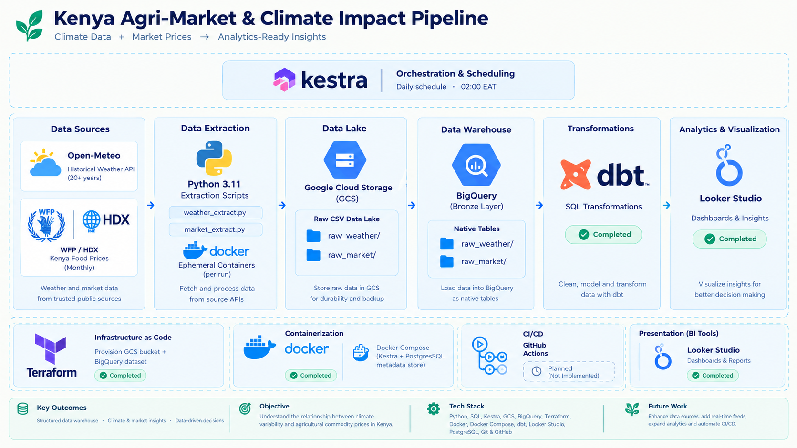

# Kenya Agri-Market & Climate Impact Pipeline




> **An end-to-end batch data engineering pipeline that analyzes the relationship between climate variability and agricultural commodity prices across Kenya.**
>
> *Climate Data + Market Prices → Analytics-Ready Insights*


---

## Table of Contents

- [Problem Statement](#problem-statement)
- [Objective](#objective)
- [Architecture Overview](#architecture-overview)
- [Tech Stack](#tech-stack)
- [Project Structure](#project-structure)
- [Pipeline Flow (Deep Dive)](#pipeline-flow-deep-dive)
  - [Phase 1 — Extract](#phase-1--extract)
  - [Phase 2 — Load to Data Lake (GCS)](#phase-2--load-to-data-lake-gcs)
  - [Phase 3 — Load to Data Warehouse (BigQuery Bronze)](#phase-3--load-to-data-warehouse-bigquery-bronze)
  - [Phase 4 — Transform (dbt)](#phase-4--transform-dbt)
- [Data Sources & Schema](#data-sources--schema)
  - [Weather Data (Producer Hubs)](#weather-data-producer-hubs)
  - [Market Data (Consumer Hubs)](#market-data-consumer-hubs)
- [Infrastructure as Code (Terraform)](#infrastructure-as-code-terraform)
- [Orchestration (Kestra)](#orchestration-kestra)
- [Architecture Decision Records (ADR)](#architecture-decision-records-adr)
- [Getting Started](#getting-started)
  - [Prerequisites](#prerequisites)
  - [1. Clone the Repository](#1-clone-the-repository)
  - [2. GCP Credentials Setup](#2-gcp-credentials-setup)
  - [3. Provision Infrastructure with Terraform](#3-provision-infrastructure-with-terraform)
  - [4. Start the Orchestration Stack](#4-start-the-orchestration-stack)
  - [5. Deploy the Pipeline Flow to Kestra](#5-deploy-the-pipeline-flow-to-kestra)
- [Lessons Learned & Engineering Notes](#lessons-learned--engineering-notes)
- [Future Work](#future-work)
- [License](#license)

---

## Problem Statement

Agriculture is the backbone of Kenya's economy — it employs over 70% of the rural population and directly influences the country's GDP (Gross Domestic Product), food security, and regional stability. Yet, it is one of the sectors most vulnerable to extreme climate events. A single prolonged drought in the Rift Valley can cascade into supply shortages in Nairobi markets within weeks, driving food inflation that hits the lowest-income households the hardest.

Despite this, the relationship between **climate patterns** (rainfall, temperature, evapotranspiration) and **commodity price fluctuations** remains poorly quantified at scale. The data exists — scattered across weather APIs and humanitarian datasets — but no unified, analytics-ready pipeline connects these two domains for Kenya.

---

## Objective

This pipeline is designed to close that gap. Specifically, it:

1. **Extracts** 20+ years of daily historical weather data for Kenya's key **producer counties** (the agricultural heartland where food is grown).
2. **Extracts** monthly staple commodity price records for key **consumer hubs** (the urban markets where food is sold and consumed).
3. **Lands** the raw data into Google Cloud Storage as an immutable backup.
4. **Loads** it into native BigQuery tables to form a performant Bronze layer.
5. **Transforms** the raw data via dbt into a Star Schema — fact and dimension tables ready for downstream BI analytics.

The end goal is a structured data warehouse that analysts and data scientists can query to answer questions like:
- *"How does a 30-day rainfall deficit in Trans Nzoia correlate with maize price spikes in Nairobi?"*
- *"Which consumer markets are most sensitive to temperature anomalies in producer regions?"*
- *"What is the historical lag between a climate event and its downstream market impact?"*

---

## Architecture Overview

The diagram below illustrates the full end-to-end pipeline — from raw data sources to analytics-ready outputs — along with the supporting infrastructure layer.


**Pipeline Stages at a Glance:**

| Stage | Tool / Service | Output |
|---|---|---|
| **Orchestration** | Kestra (Daily @ 02:00 EAT) | Scheduled DAG execution |
| **Data Extraction** | Python 3.11 in ephemeral Docker containers | Raw CSV files |
| **Data Lake** | Google Cloud Storage (GCS) | Immutable raw backup |
| **Data Warehouse** | Google BigQuery (Bronze layer) | Native columnar tables |
| **Transformations** | dbt *(In Progress)* | Star Schema models |
| **Analytics Ready** | Looker Studio / Metabase *(Planned)* | BI dashboards |
| **Infrastructure** | Terraform | GCS bucket + BigQuery dataset |
| **Containerization** | Docker Compose | Kestra + PostgreSQL metadata store |
| **CI/CD** | GitHub Actions *(Planned)* | Linting, plan validation, testing |

```
┌──────────────────────────────────────────────────────────────────────────────────┐
│                           ORCHESTRATION (Kestra)                                │
│                    Daily CRON @ 02:00 EAT · Dockerized                          │
├─────────────────────────────┬────────────────────────────────────────────────────┤
│                             │                                                    │
│   ┌─────────────────────┐   │   ┌─────────────────────┐                          │
│   │  EXTRACT (Weather)  │   │   │  EXTRACT (Market)   │                          │
│   │  Python 3.11-slim   │   │   │  Python 3.11-slim   │                          │
│   │  Docker Container   │   │   │  Docker Container   │                          │
│   └────────┬────────────┘   │   └────────┬────────────┘                          │
│            │                │            │                                        │
│            ▼                │            ▼                                        │
│   ┌─────────────────────────────────────────────────────┐                        │
│   │          DATA LAKE — Google Cloud Storage (GCS)      │                        │
│   │   gs://kenya-agri-climate-lake-bucket/               │                        │
│   │     ├── raw_weather/   (daily CSV drops)             │                        │
│   │     └── raw_market/    (monthly CSV drops)           │                        │
│   │   Immutable Landing Zone & Backup                    │                        │
│   └──────────────────────┬──────────────────────────────┘                        │
│                          │                                                       │
│                          ▼                                                       │
│   ┌─────────────────────────────────────────────────────┐                        │
│   │     DATA WAREHOUSE — Google BigQuery (Bronze)        │                        │
│   │   kenya_agri_market.raw_weather  (WRITE_APPEND)      │                        │
│   │   kenya_agri_market.raw_market   (WRITE_APPEND)      │                        │
│   │   Native Tables · Partition-Ready · Columnar         │                        │
│   └──────────────────────┬──────────────────────────────┘                        │
│                          │                                                       │
│                          ▼                                                       │
│   ┌─────────────────────────────────────────────────────┐                        │
│   │          TRANSFORM — dbt (In Progress)               │                        │
│   │   Star Schema: Fact Tables + Dimension Tables        │                        │
│   │   → BI / Analytics Layer                             │                        │
│   └─────────────────────────────────────────────────────┘                        │
└──────────────────────────────────────────────────────────────────────────────────┘
```

---

## Tech Stack

| Layer | Technology | Purpose |
|---|---|---|
| **Infrastructure** | Terraform | IaC — provisions the GCS bucket and BigQuery dataset declaratively |
| **Orchestration** | Kestra (Dockerized) | Workflow scheduling, task execution, and pipeline DAG management |
| **Containerization** | Docker / Docker Compose | Kestra server, PostgreSQL metadata backend, and ephemeral task runners |
| **Extraction** | Python 3.11 | Data pull scripts running inside ephemeral Docker containers |
| **Data Lake** | Google Cloud Storage (GCS) | Raw CSV landing zone — immutable backup layer |
| **Data Warehouse** | Google BigQuery | Native Bronze layer tables — columnar storage, partition-ready |
| **Transformations** | dbt (Data Build Tool) | SQL-based modeling into Star Schema *(In Progress)* |
| **Data Sources** | Open-Meteo API, WFP / HDX | Historical climate data and agricultural commodity prices |
| **CI/CD** | GitHub Actions | Linting, Terraform plan validation, dbt model testing *(Planned)* |

---

## Project Structure

```
kenya-agri-climate-data-pipeline/
│
├── README.md                          # This document — master project documentation
├── .env                               # Environment variables for Docker Compose (gitignored)
├── .env.example                       # Template for required environment variables
├── .gitignore                         # Security & hygiene rules for version control
│
├── main.tf                            # Terraform — GCS bucket + BigQuery dataset provisioning
├── variable.tf                        # Terraform — parameterized variables (project, region, etc.)
│
├── docker-compose.yml                 # Kestra server + PostgreSQL metadata store
│
├── assets/                            # Project documentation assets
│   └── project_overview.png           # End-to-end architecture diagram
│
├── credentials/                       # GCP service account key (gitignored)
│   └── gcp-service-account.json
│
├── extract/                           # Python extraction scripts
│   ├── weather_extract.py             # Open-Meteo API → daily weather for producer counties
│   └── market_extract.py             # WFP/HDX dataset → commodity prices for consumer hubs
│
├── orchestration/                     # Kestra workflow definitions
│   └── main_pipeline.yml              # Full EL pipeline — extract, upload to GCS, load to BQ
│
├── warehouse/                         # BigQuery SQL scripts
│   └── scripts/
│       └── init_bronze.sql            # One-time Bronze layer setup — historical backfill
│
└── analytics/                         # dbt project (In Progress)
    └── (dbt models will live here)
```

---

## Pipeline Flow (Deep Dive)

### Phase 1 — Extract

Two purpose-built Python scripts handle data extraction, each designed for a distinct source domain. Kestra spawns each script inside an **ephemeral `python:3.11-slim` Docker container** — this guarantees a clean, reproducible execution environment on every run with zero dependency leakage onto the host.

#### `weather_extract.py` — Climate Data

- **Source:** [Open-Meteo Historical Weather API](https://open-meteo.com/) — free, no API key required
- **Scope:** 3 producer counties in Kenya's agricultural heartland:

  | County | Latitude | Longitude | Significance |
  |---|---|---|---|
  | Trans Nzoia | 1.0507 | 34.9570 | Kenya's breadbasket (maize belt) |
  | Uasin Gishu | 0.5527 | 35.3027 | Major wheat & maize producer |
  | Nakuru | -0.3071 | 36.0722 | Key horticultural county |

- **Extracted Variables:**

  | Variable | Description |
  |---|---|
  | `temperature_2m_max` | Daily maximum temperature at 2m height (°C) |
  | `temperature_2m_min` | Daily minimum temperature at 2m height (°C) |
  | `precipitation_sum` | Total daily precipitation (mm) |
  | `wind_speed_10m_max` | Maximum wind speed at 10m height (km/h) |
  | `shortwave_radiation_sum` | Total incoming solar radiation (MJ/m²) |
  | `et0_fao_evapotranspiration` | FAO-56 reference evapotranspiration (mm) |

- **Granularity:** Daily records, timezone-aware (`Africa/Nairobi`)
- **Date Range:** Controlled by `START_DATE` and `END_DATE` environment variables — supports both historical backfill (20+ years) and daily incremental runs.
- **Output:** `producer_weather_extract.csv`

#### `market_extract.py` — Commodity Price Data

- **Source:** [World Food Programme (WFP) Kenya Food Prices](https://data.humdata.org/) via the Humanitarian Data Exchange (HDX)
- **Scope:** 3 consumer hub counties (major urban markets):

  | County | Significance |
  |---|---|
  | Nairobi | Capital city — largest consumer market |
  | Mombasa | Coastal hub — import/export gateway |
  | Turkana | Arid/semi-arid — food insecurity hotspot |

- **Extracted Fields:** `date`, `county` (admin2), `market`, `commodity`, `unit`, `price_kes`
- **Filtering Logic:** The full WFP dataset covers all of Kenya. The script filters server-side to extract only rows matching the target consumer hubs, dramatically reducing downstream data volume.
- **Schema Guard:** The script validates expected column headers on every run and raises a `ValueError` if the upstream schema changes — an early-warning mechanism against silent data corruption.
- **Output:** `consumer_market_extract.csv`

---

### Phase 2 — Load to Data Lake (GCS)

After extraction, Kestra uploads both CSV files to Google Cloud Storage using the `io.kestra.plugin.gcp.gcs.Upload` plugin. Files are organized with dynamic, date-stamped object paths:

```
gs://kenya-agri-climate-lake-bucket/
├── raw_weather/
│   └── producer_weather_2005-01-01_to_2025-08-14.csv
├── raw_market/
│   └── consumer_market_2005-01-01_to_2025-08-14.csv
```

**Why GCS as a landing zone?**

- It serves as an **immutable physical backup** of every extraction run. If a specific day's data pull needs to be audited or replayed, the raw artifacts are always available.
- It **decouples extraction from warehousing** — if the BigQuery load step fails, the extracted data is not lost and can be retried without re-hitting the source APIs.

---

### Phase 3 — Load to Data Warehouse (BigQuery Bronze)

Once the CSVs land in GCS, Kestra triggers a `io.kestra.plugin.gcp.bigquery.Load` task to physically ingest the data into native BigQuery tables using `WRITE_APPEND`. This is the **Bronze layer** — raw, untransformed data stored in BigQuery's native columnar format (Capacitor).

| BigQuery Table | Source | Write Mode |
|---|---|---|
| `kenya_agri_market.raw_weather` | `raw_weather/*.csv` | `WRITE_APPEND` |
| `kenya_agri_market.raw_market` | `raw_market/*.csv` | `WRITE_APPEND` |

**Historical Backfill:** For the initial 20-year historical load, a one-time SQL script ([`init_bronze.sql`](warehouse/scripts/init_bronze.sql)) was run. It dropped any legacy external tables and bulk-loaded all historical CSVs from GCS into native tables using `LOAD DATA OVERWRITE`. From that point forward, daily incremental appends are handled automatically by Kestra.

---

### Data Transformation & Dimensional Modeling (Completed)

The dbt transformation layer was successfully implemented, connecting to the BigQuery Bronze layer to transform raw climate and market price data into an analytics-ready **Star Schema** optimized for downstream business intelligence and analytical queries.

**Implemented models:**

- **Fact Table:** `fct_climate_market` — integrates climate observations and market prices using shared dimensions, including county and date, enabling cross-domain analytical queries.
- **County Dimension:** `dim_county` — provides county-level metadata, including region and producer/consumer classification.
- **Commodity Dimension:** `dim_commodity` — organizes commodities and their respective categories for market analysis.
- **Date Dimension:** `dim_date` — provides a date dimension to support time-series analysis and temporal comparisons.

**dbt model architecture:**

```text
bronze/          → Raw source references
staging/         → Cleaned, typed, and standardized data
marts/
  ├── dim_county.sql
  ├── dim_commodity.sql
  ├── dim_date.sql
  └── fct_climate_market.sql
```

The completed transformation layer separates raw data ingestion from analytical modeling, enabling BI tools such as **Looker Studio** and **Metabase** to query structured, analytics-ready datasets without directly processing the raw Bronze layer.

This establishes a foundation for analyzing relationships between climate conditions and agricultural market prices across counties and over time.


## Data Sources & Schema

### Weather Data (Producer Hubs)

**Source:** [Open-Meteo Historical Weather API](https://open-meteo.com/)  
**Update Frequency:** Daily  
**Coverage:** 2005-01-01 to present

| Column | Type | Description |
|---|---|---|
| `county` | STRING | Producer county name (join key to dimension tables) |
| `date` | DATE | Observation date (`Africa/Nairobi` timezone) |
| `temp_max_c` | FLOAT | Maximum temperature at 2m height (°C) |
| `temp_min_c` | FLOAT | Minimum temperature at 2m height (°C) |
| `precipitation_mm` | FLOAT | Total daily precipitation (mm) |
| `wind_speed_max_kmh` | FLOAT | Maximum wind speed at 10m height (km/h) |
| `solar_radiation_mj_m2` | FLOAT | Total shortwave radiation (MJ/m²) |
| `evapotranspiration_mm` | FLOAT | FAO-56 reference evapotranspiration (mm) |

### Market Data (Consumer Hubs)

**Source:** [WFP Kenya Food Prices via HDX](https://data.humdata.org/)  
**Update Frequency:** Monthly  
**Coverage:** Historical records available from ~2006

| Column | Type | Description |
|---|---|---|
| `date` | DATE | Price observation date |
| `county` | STRING | Consumer hub county (join key to dimension tables) |
| `market` | STRING | Specific market name within the county |
| `commodity` | STRING | Agricultural commodity (e.g., Maize, Beans, Rice) |
| `unit` | STRING | Unit of measurement (e.g., KG, 90 KG bag) |
| `price_kes` | FLOAT | Price in Kenyan Shillings (KES) |

**Tracked Commodities include:** Maize, Wheat Flour, Rice, Beans, Sorghum, Millet, Sugar, Cooking Oil, and other staple foodstuffs.

---

## Infrastructure as Code (Terraform)

Terraform is used to declaratively provision all GCP resources. This ensures the infrastructure is reproducible, version-controlled, and can be torn down cleanly.

**Resources provisioned by [`main.tf`](main.tf):**

| Resource | Terraform Resource Type | Name / ID |
|---|---|---|
| Data Lake (GCS Bucket) | `google_storage_bucket` | `kenya-agri-climate-lake-bucket` |
| Data Warehouse (BigQuery) | `google_bigquery_dataset` | `kenya_agri_market` |

**Key configuration in [`variable.tf`](variable.tf):**

| Variable | Default Value | Description |
|---|---|---|
| `credentials` | `./credentials/gcp-service-account.json` | Path to GCP service account key |
| `project` | `kestra-sandbox-504410` | GCP project ID |
| `region` | `europe-west1` | GCP region for resources |
| `location` | `EU` | Multi-region location for GCS/BQ |
| `bq_dataset_name` | `kenya_agri_market` | BigQuery dataset name |
| `gcs_bucket_name` | `kenya-agri-climate-lake-bucket` | GCS bucket name |

**GCS Lifecycle Rule:** An `AbortIncompleteMultipartUpload` rule with a 1-day age is configured to automatically clean up any failed or partial uploads — a small but important hygiene measure for production buckets.

---

## Orchestration (Kestra)

### Docker Compose Stack

The orchestration layer is fully containerized via [`docker-compose.yml`](docker-compose.yml):

| Service | Image | Port | Purpose |
|---|---|---|---|
| `postgres` | `postgres:15` | `5433` (host) | Kestra's metadata store (flow state, logs, history) |
| `kestra` | `kestra/kestra:latest` | `8080` (host) | Orchestration server (standalone mode) |

**Critical Design Decisions:**

- **`network_mode: host`**: Kestra runs with `networkMode: host` rather than the default Docker bridge network. This was a deliberate decision to **bypass firewall restrictions** in the development environment. When Kestra spawns ephemeral Docker containers for Python tasks, those child containers need to reach the internet (to call the Open-Meteo API and download the HDX dataset). On a bridge network behind certain firewalls, this outbound traffic is silently blocked. Switching to host networking resolved this entirely. *(See [ADR-002](#adr-002-kestra-networkmode-host--firewall-bypass-for-ephemeral-containers) for full analysis.)*

- **Docker Socket Mounting**: The Docker socket (`/var/run/docker.sock`) is mounted into the Kestra container so that Kestra can spawn sibling containers (the `python:3.11-slim` task runners) on the host's Docker daemon. This is the Docker-in-Docker (DinD) pattern — ephemeral, stateless task execution.

- **Credentials Volume**: The GCP service account key is mounted read-only (`ro`) at `/app/credentials/` inside the Kestra container. The `GOOGLE_APPLICATION_CREDENTIALS` environment variable points Kestra's GCP plugins to this file.

- **PostgreSQL Backend**: Kestra uses PostgreSQL (not the default H2 in-memory DB) for persistent metadata — this ensures flow execution history, logs, and state survive container restarts. PostgreSQL is mapped to port `5433` on the host to avoid conflicts with any local PostgreSQL instance on the default `5432`.

### Pipeline Flow Definition

The pipeline is defined in [`main_pipeline.yml`](orchestration/main_pipeline.yml):

| Property | Value |
|---|---|
| **Namespace** | `dev.data_engineering` |
| **Flow ID** | `kenya_agri_climate_pipeline` |
| **Trigger** | Daily CRON at `02:00 AM EAT` (`0 2 * * *`) |
| **Inputs** | Optional `start_date` and `end_date` (STRING, format `YYYY-MM-DD`) |

**Default date behavior:** If `start_date` / `end_date` are not provided (i.e., triggered by the daily schedule), both default to **yesterday's date** using Kestra's Pebble templating engine:

```
{{ execution.startDate | dateAdd(-1, 'DAYS') | date('yyyy-MM-dd') }}
```

**Task Execution Order (Sequential):**

```
1. extract_weather_data     →  Python in Docker  →  producer_weather_extract.csv
2. extract_market_data      →  Python in Docker  →  consumer_market_extract.csv
3. upload_weather_to_gcs    →  Kestra GCP Plugin →  gs://bucket/raw_weather/...
4. upload_market_to_gcs     →  Kestra GCP Plugin →  gs://bucket/raw_market/...
5. load_weather_to_bigquery →  Kestra GCP Plugin →  kenya_agri_market.raw_weather
6. load_market_to_bigquery  →  Kestra GCP Plugin →  kenya_agri_market.raw_market
```

---

## Architecture Decision Records (ADR)

### ADR-001: Bronze Layer Storage — Native BigQuery Tables vs. External Tables

**Status:** ✅ Decided — Native BigQuery Tables

**Context:**
After establishing GCS as the raw data lake, the data needed to be exposed to BigQuery for dbt transformations. The decision was between using External Tables (pointed at GCS) or loading data into native BigQuery tables.

**Considered Alternative — External Tables:**
BigQuery External Tables pointed directly at `gs://kenya-agri-climate-lake-bucket/raw_*/*.csv`. This would have avoided data duplication and kept GCS as the single source of truth.

**Trade-off Analysis:**

| Factor | External Tables | Native BigQuery Tables |
|---|---|---|
| Data duplication | ❌ None | ✅ Minimal (CSV + BQ) |
| Query performance | ❌ Poor (full CSV scan) | ✅ Columnar Capacitor format |
| Partition pruning | ❌ Not supported | ✅ Supported |
| Resilience | ❌ Fragile (GCS-coupled) | ✅ Decoupled from GCS |
| Downstream dbt stability | ❌ Brittle | ✅ Stable native tables |

**Final Decision:**
A **Native Bronze Layer** was implemented. GCS serves strictly as a transient landing zone and immutable backup. Kestra orchestrates the physical ingestion of CSVs into native BigQuery tables using `WRITE_APPEND`. This guarantees:
- ✅ High query performance via columnar storage
- ✅ Future partition pruning on date columns
- ✅ Isolated, resilient downstream transformations (dbt reads from stable native tables, not volatile object stores)
- ✅ GCS remains available for auditing, replays, and disaster recovery

---

### ADR-002: Kestra `networkMode: host` — Firewall Bypass for Ephemeral Containers

**Status:** ✅ Decided — Host Networking (dev environment)

**Context:**
During development, ephemeral Docker containers spawned by Kestra (for Python extraction tasks) were silently failing to make outbound HTTP requests to the Open-Meteo API and HDX.

**Root Cause:**
The default Docker bridge network was being blocked by the host machine's firewall rules. The containers could resolve DNS but could not establish TCP connections to external endpoints.

**Decision:**
Kestra's Docker task runner is configured to use `networkMode: host`, which gives the ephemeral containers direct access to the host's network stack, bypassing the bridge network entirely.

**Trade-off:**

| Aspect | Impact |
|---|---|
| Network isolation | ❌ Sacrificed between container and host |
| Development velocity | ✅ Unblocked immediately |
| Production readiness | ⚠️ Requires proper firewall egress policies in production |

In a production environment, this should be addressed with proper firewall rules or a Docker network with explicit egress policies rather than blanket host networking. For this development/sandbox environment, the pragmatic trade-off is acceptable.

---

## Getting Started

### Prerequisites

Ensure the following are installed and configured before proceeding:

| Requirement | Version | Notes |
|---|---|---|
| [Google Cloud Platform](https://cloud.google.com/) account | — | With a project created |
| [Terraform](https://developer.hashicorp.com/terraform/downloads) | v1.0+ | For infrastructure provisioning |
| [Docker](https://docs.docker.com/get-docker/) | Latest | For containerized execution |
| [Docker Compose](https://docs.docker.com/compose/install/) | v2+ | For the Kestra orchestration stack |
| GCP Service Account | — | See required IAM roles below |

**Required GCP IAM Roles for the Service Account:**

| Role | Purpose |
|---|---|
| `roles/storage.admin` | GCS bucket creation and object management |
| `roles/bigquery.admin` | BigQuery dataset and table creation |

---

### 1. Clone the Repository

```bash
git clone https://github.com/jude-craft/kenya-agri-climate-data-pipeline.git
cd kenya-agri-climate-data-pipeline
```

---

### 2. GCP Credentials Setup

Place your GCP service account JSON key at:

```
credentials/gcp-service-account.json
```

> ⚠️ **Security:** The `credentials/` directory is listed in `.gitignore`. Never commit service account keys to version control.

Then create a `.env` file in the project root (use `.env.example` as a reference):

```env
# PostgreSQL metadata store credentials
POSTGRES_DB=kestra
POSTGRES_USER=kestra
POSTGRES_PASSWORD=<your-secure-password>

# Host Port Mappings
POSTGRES_HOST_PORT=5433
KESTRA_HOST_PORT=8080

# Kestra Web UI Authentication
KESTRA_ADMIN_EMAIL=admin@admin.com
KESTRA_ADMIN_PASSWORD=<your-secure-password>
```

---

### 3. Provision Infrastructure with Terraform

```bash
terraform init
terraform plan
terraform apply
```

This creates the following GCP resources:
- ✅ GCS bucket: `kenya-agri-climate-lake-bucket`
- ✅ BigQuery dataset: `kenya_agri_market`

---

### 4. Start the Orchestration Stack

```bash
docker compose up -d
```

The Kestra UI will be available at **`http://localhost:8080`**. Log in with the credentials you set in `.env`.

Verify both services are running:

```bash
docker compose ps
```

---

### 5. Deploy the Pipeline Flow to Kestra

Upload the flow definition file (`orchestration/main_pipeline.yml`) via the Kestra UI or CLI:

**Via the Kestra UI:**
1. Open `http://localhost:8080`
2. Navigate to **Flows → Create**
3. Paste the contents of `orchestration/main_pipeline.yml`
4. Save the flow

**Via the Kestra CLI (if installed):**
```bash
kestra flow namespace update dev.data_engineering orchestration/main_pipeline.yml
```

The flow will begin executing on its daily schedule (02:00 EAT), or you can trigger it manually with custom `start_date` and `end_date` inputs for historical backfill.

**For a historical backfill** (e.g., 20 years of weather + market data):
1. Trigger the flow manually in the Kestra UI
2. Provide inputs: `start_date = 2005-01-01`, `end_date = 2025-08-14`
3. After the flow completes, run [`init_bronze.sql`](warehouse/scripts/init_bronze.sql) in the BigQuery console to perform the bulk historical load into native Bronze tables

---

## Lessons Learned & Engineering Notes

1. **Ephemeral Containers Are Worth the Overhead.** Running extraction scripts in throwaway Docker containers (vs. directly on the Kestra host) adds a few seconds of startup time per task. But the benefits — reproducibility, dependency isolation, and zero environment drift — are well worth it for a pipeline that needs to run reliably for months unattended.

2. **GCS as a Backup, Not a Source of Truth.** GCS was initially treated as the source of truth via external tables. After experiencing the fragility firsthand (one misplaced `gsutil rm` could cascade into broken dbt models), the architecture pivoted to native BigQuery tables and relegated GCS to a backup role. The slight data duplication is a small price for operational resilience.

3. **Kestra's Pebble Templating Is Powerful.** The ability to default `start_date` and `end_date` to yesterday's date using inline expressions (`{{ execution.startDate | dateAdd(-1, 'DAYS') | date('yyyy-MM-dd') }}`) means the same flow definition handles both daily incremental runs and ad-hoc historical backfills — no code changes needed.

4. **Schema Validation at the Edge.** A defensive `try/except` block in `market_extract.py` validates the HDX dataset's column headers on every run. Upstream humanitarian datasets change schema without warning. This early-warning mechanism ensures breaking changes are caught at extraction time, not days later when analysts see `NULL` columns in their dashboards.

5. **Firewall Awareness in Containerized Environments.** The `networkMode: host` lesson was hard-won. Kestra's task logs showed no obvious errors — the Python script simply timed out on `requests.get()`. It took debugging at the Docker network level to identify that the bridge network was being firewalled. Always test outbound connectivity from your task containers independently before assuming application-level failures.

---

## Future Work

| Priority | Task | Status |
|---|---|---|
| 🟡 Medium | **Partitioning & Clustering** — Apply BigQuery partitioning on `date` and clustering on `county` to optimize query performance at scale | ⏳ Planned |
| 🟢 Low | **CI/CD** — GitHub Actions pipeline for linting, Terraform plan validation, and dbt model testing | ⏳ Planned |
| 🟢 Low | **Alerting** — Kestra failure notifications via Slack or email for pipeline observability | ⏳ Planned |

---

## License

This project is for educational and research purposes.

---

*Built with ☕ and curiosity — analyzing how the sky affects the price of produce.*
